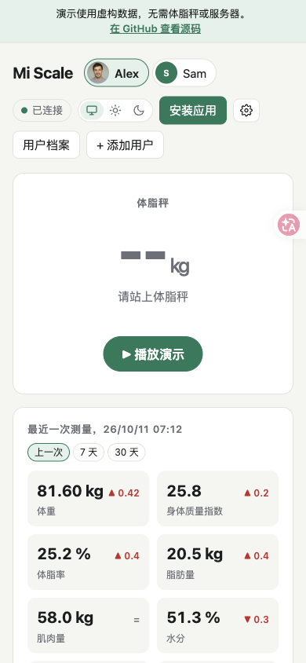
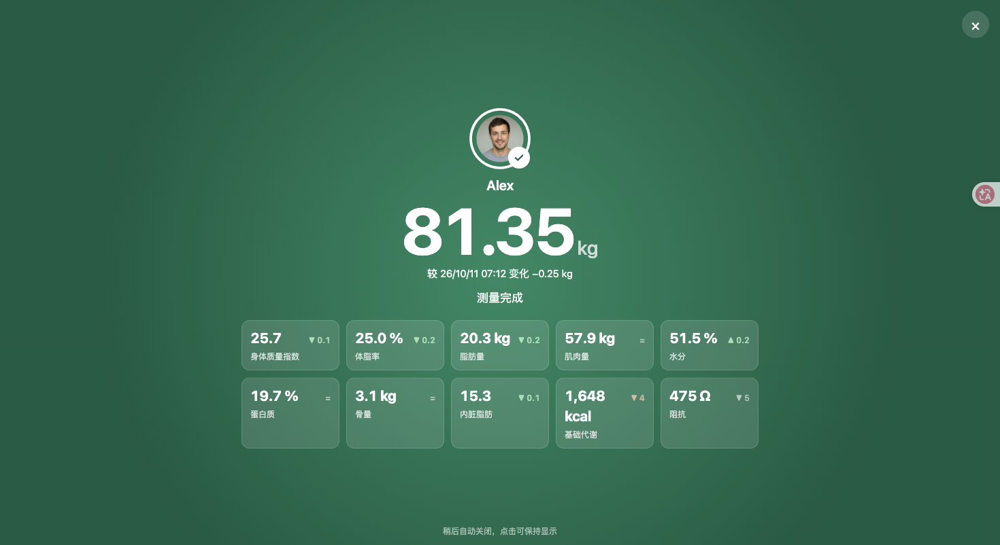

# Mi Scale Dashboard

小米体脂秤 2 的本地看板。放在秤附近的电脑接收蓝牙广播，网页实时显示体重，自动匹配用户，并保存身体成分和历史记录。无需小米账号、Zepp Life 或云服务。

这是 [BrOrlandi/miscale-dashboard](https://github.com/BrOrlandi/miscale-dashboard) 的中文 fork。网页、通知和 AI 分析默认使用简体中文，设置中保留英语、葡萄牙语与跟随浏览器的选项。

[English](README.en.md) | [Português (Brasil)](README.pt-BR.md)

## 先打开中文页面

如果当前电脑已安装 Python 3.11 或更新版本：

```bash
git clone https://github.com/JosssphZhou/miscale-dashboard.git
cd miscale-dashboard
python3 -m venv .venv
. .venv/bin/activate
pip install -r requirements.txt
cp .env.example .env
printf '\nMISCALE_DB=./data/miscale.db\n' >> .env
python -m uvicorn app.main:app --env-file .env --host 127.0.0.1 --port 8800
```

上述命令已设置本地数据库路径。原版默认路径 `/data/miscale.db` 用于容器，直接运行时需改为可写的本地路径。

打开 <http://localhost:8800>。也可运行 `scripts/start-local.sh` 启动本地服务，脚本默认端口为 18800，且保持蓝牙关闭。初次启动时没有称重数据，页面显示“等待启用蓝牙”。默认配置关闭蓝牙扫描、通知和 AI 分析，可先查看中文页面。

### 到这里需要你操作

1. 查看秤背面的型号，确认是 **XMTZC05HM（小米体脂秤 2）**。
2. 将运行服务的电脑与秤放在同一房间或相邻房间。电脑须支持低功耗蓝牙。
3. 点击“添加用户”，填写姓名、身高、出生日期、性别和大致体重。
4. 停止当前服务，再运行 `scripts/start-local.sh --connect`。若使用 Docker，则将 `.env` 中的 `MISCALE_SCANNER` 改为 `on` 并重启容器。
5. 如果系统请求蓝牙权限，请允许运行服务的终端使用蓝牙。
6. 赤脚站上秤，体重稳定后再等待约 3 至 5 秒，直到身体成分测量完成。

体脂秤发送广播，不需要在系统蓝牙设置里配对。上游支持 Linux + BlueZ；macOS 和 Windows 可尝试直接运行 Python，真实接收仍需实机验证。macOS 的 Docker 容器无法使用本方案的 Linux BlueZ 接口。

**XMTZC04HM（小米体重秤 2）和其他型号暂不支持。** 型号不同请先确认兼容性。

## 功能

- 实时称重：所有打开的网页同步显示体重稳定过程、阻抗和身体成分，测量结束后更新看板。
- 多人档案：按最近一次体重匹配用户。超过允许偏差时标为“未识别用户”，可在历史记录中指定用户。支持头像照片。
- 身体成分：使用 openScale 的公开公式估算体脂率、脂肪量、肌肉量、水分、蛋白质、骨量、内脏脂肪和基础代谢。
- 变化对比：与上一次、7 天前或 30 天前的记录对比，用箭头标示变化。
- 趋势图与历史：体重、7 天移动平均和体脂率，可查看 30 天、90 天、1 年或全部记录。
- 可选通知：每次称重后发送 JSON webhook 或 Telegram 消息。
- 可选 AI 分析：每周总结趋势，支持 OpenAI 兼容服务或本地 Ollama，并在网页逐步显示生成文字。
- 简体中文、英语和葡萄牙语；千克或磅；浅色、深色或跟随系统。
- 手机安装：支持添加到主屏幕，离线时可打开应用页面。
- 单个 Python 服务，SQLite 存储。Chart.js 随项目提供，图表无需联网加载。

## 查看演示

演示使用两个虚构用户的数据，不需要体脂秤、蓝牙或后端服务。演示分析由固定语句生成，没有调用 AI。刷新页面会清除所有修改。

```bash
python scripts/build_demo.py
python -m http.server -d site 8000
```

打开 <http://localhost:8000>，点击“播放演示”，查看从称重到身体成分和每周分析的过程。

[上游英语在线演示](https://brorlandi.github.io/miscale-dashboard/) 和 [上游宣传视频](https://youtu.be/ajvoJN0Qh_4) 保留原文。视频工程见 [video/README.md](video/README.md)。旧截图和视频是上游素材；本 fork 的中文页面截图见下方。所有演示数据均为虚构，Alex 的头像由 AI 生成，见 [演示素材说明](docs/demo/README.md)。

## 中文界面





## 在 Linux 上连接体脂秤

以下设备可作为运行服务的电脑：

- Raspberry Pi 3、4、5 或 Zero 2 W，使用内置蓝牙。
- 带 Intel AX200、AX201、AX210 等无线网卡的迷你电脑或 NUC。上游开发设备为 Intel N100 + AX201。
- 配备 USB 蓝牙 4.0 或更新适配器的 Linux 电脑。

Linux 使用 BlueZ。先确认蓝牙适配器可以接收广播：

```bash
bluetoothctl show         # 应看到控制器，且 Powered 为 yes
sudo bluetoothctl scan le # 站上秤后，应出现名为 MIBFS 的设备
```

### 使用 Docker

```bash
git clone https://github.com/JosssphZhou/miscale-dashboard.git
cd miscale-dashboard
cp .env.example .env
# 完成型号确认后，将 .env 中的 MISCALE_SCANNER 改为 on。
docker compose up -d --build
```

打开 `http://<服务器地址>:8800`，创建用户档案，然后赤脚称重。

容器挂载 `./data` 保存数据库和照片，并通过 `/run/dbus` 访问主机的 BlueZ。`apparmor=unconfined` 用于避免 Docker 默认 AppArmor 规则阻止 D-Bus。无需 `privileged` 或主机网络模式；无 AppArmor 的系统可保留该项。

### 直接运行 Python

使用前面的本地安装步骤，并配置 `.env`：

```dotenv
MISCALE_DB=./data/miscale.db
MISCALE_SCANNER=on
```

要供家庭网络中的其他设备访问，使用 `--host 0.0.0.0`。服务没有登录功能，仅在可信网络中使用。

需要长期运行时，可在 Linux 创建 systemd 服务：

```ini
# /etc/systemd/system/miscale-dashboard.service
[Unit]
Description=Mi Scale Dashboard
After=bluetooth.target network-online.target

[Service]
WorkingDirectory=/opt/miscale-dashboard
ExecStart=/opt/miscale-dashboard/.venv/bin/uvicorn app.main:app --env-file /opt/miscale-dashboard/.env --host 0.0.0.0 --port 8800
Restart=always

[Install]
WantedBy=multi-user.target
```

此示例的 `.env` 中将数据库设置为 `/opt/miscale-dashboard/data/miscale.db`。

## 安装到手机

Android 的 Chrome 或 Edge 可通过页面中的“安装应用”按钮或浏览器菜单安装。iPhone 和 iPad 在 Safari 中选择“分享”，再选择“添加到主屏幕”。

应用安装与离线缓存通常需要 HTTPS。可使用带证书的 Caddy、Traefik、nginx，或 `tailscale serve`。普通 `http://<服务器地址>:8800` 可在浏览器中使用；iOS 仍可添加到主屏幕，Android 不会提供安装按钮。

## 配置参考

所有设置均为可选。Docker 和带 `--env-file .env` 的 Python 服务从 `.env` 读取配置。网页中可更改语言、体重单位和识别用户的允许偏差。

| 变量 | 默认值 | 用途 |
| --- | --- | --- |
| `TZ` | `.env.example` 为 `Asia/Taipei` | 测量时间和分析计划的时区 |
| `MISCALE_SCALE_MAC` | 空 | 仅接收指定体脂秤。空值接收范围内所有支持的体脂秤 |
| `MISCALE_DB` | `/data/miscale.db` | SQLite 路径，照片保存在同级 `photos/` 目录 |
| `MISCALE_LANG` | `zh-CN` | 通知语言，可选 `zh-CN`、`en`、`pt-BR` |
| `MISCALE_PUBLIC_URL` | 空 | 通知附带的看板链接 |
| `MISCALE_WEBHOOK_URL` | 空 | 称重后向该地址发送 JSON |
| `MISCALE_TELEGRAM_TOKEN` | 空 | 从 [@BotFather](https://t.me/BotFather) 获取的机器人令牌 |
| `MISCALE_TELEGRAM_CHAT_ID` | 空 | 接收通知的聊天 ID |
| `MISCALE_NOTIFY_WAIT` | `25` | 发送通知前等待阻抗的秒数 |
| `MISCALE_AI_API_KEY` | 空 | AI 服务密钥；空值默认关闭分析 |
| `MISCALE_AI_BASE_URL` | `https://api.openai.com/v1` | OpenAI 兼容接口地址 |
| `MISCALE_AI_MODEL` | `gpt-5.4-mini` | 模型或以逗号分隔的候选模型，依次尝试 |
| `MISCALE_AI_ENABLED` | 空 | `true` 可启用无需密钥的本地服务 |
| `MISCALE_AI_WEEKDAY` / `MISCALE_AI_HOUR` | `5` / `9` | 默认每周六 09:00，0 为周一 |
| `MISCALE_AI_LANG` | 跟随 `MISCALE_LANG` | 分析语言，可选 `zh-CN`、`en`、`pt-BR` |
| `MISCALE_SCANNER` | 程序默认 `on`；示例配置为 `off` | 是否接收蓝牙广播。首次安装完成连接准备后再启用 |
| `MISCALE_LOG_LEVEL` | `INFO` | Python 日志级别 |

网页语言保存在当前浏览器中；通知和真实 AI 分析使用服务器环境变量，切换网页语言不会更改已保存的分析文本。

### 查找体脂秤地址

启用蓝牙后站上秤，打开 `http://<服务器地址>:8800/api/debug/devices`。查看名称为 `MIBFS`、服务数据以 `0000181b-` 开头的设备，将地址填入 `MISCALE_SCALE_MAC` 后重启。`/api/debug/packets` 显示最近收到的原始数据包。

### 通知

测量结束后，服务器最多等待 `MISCALE_NOTIFY_WAIT` 秒获取阻抗，再发送通知。未匹配到用户的称重不会发送通知，仍保留在历史记录中。中文消息示例：

```text
⚖️ 小明：81.40 kg
较 10月11日 07:15 变化 −0.03 kg，7 天平均 81.7 kg
体脂率 25.0%（脂肪量 20.4 kg），肌肉量 57.9 kg
水分 51.4%，蛋白质 19.7%，骨量 3.1 kg
身体质量指数 25.7，内脏脂肪 15，基础代谢 1,649 kcal
阻抗 478 Ω
```

webhook 同时提供消息与原始数据，适用于 n8n、Node-RED、Home Assistant 等接收 JSON 的服务。字段保持上游格式：

```json
{
  "event": "measurement",
  "text": "中文称重通知",
  "message": "中文称重通知",
  "profile": {"id": 1, "name": "小明"},
  "measurement": {"id": 42, "weight_kg": 81.4, "impedance": 478, "metrics": {"body_fat": 25.0}}
}
```

## AI 每周分析（可选）

默认关闭。启用后每周生成一次分析，分为“有所改善”“需要留意”和“下周建议”。点击“立即生成”可分析最近 7 天。文字实时显示在所有打开的网页中，并保存到数据库；设置通知后还会发送分析结果。

模型提示要求关注多周平均值和趋势，说明数据不足，避免医学诊断。默认用简体中文，可以设置 `MISCALE_AI_LANG`。

```dotenv
# 外部 OpenAI 兼容服务：填写自己的密钥与模型。
MISCALE_AI_API_KEY=your-api-key
MISCALE_AI_BASE_URL=https://api.openai.com/v1
MISCALE_AI_MODEL=your-model

# 本地 Ollama：无需密钥。
# MISCALE_AI_ENABLED=true
# MISCALE_AI_BASE_URL=http://127.0.0.1:11434/v1
# MISCALE_AI_MODEL=your-local-model
```

OpenRouter、LM Studio、llama.cpp 和 vLLM 等服务也可使用各自的兼容地址。容器中的 `127.0.0.1` 指容器本身；本地模型在另一台主机运行时填写容器可访问的地址。

默认每周六 09:00 为本周有称重记录的用户生成分析。错过计划后，可在两天内补生成。外部服务按自身价格收费；本地模型无需支付接口费用。

启用外部 AI 后，服务商会收到本周称重与身体成分、过去 8 周的周平均，以及用户姓名、年龄、身高和性别。要将数据留在家中，可使用本地模型。webhook 的分析通知使用 `"event": "analysis"`，并包含 `analysis` 对象。

## 日常使用

- 首次称重用大致体重识别用户，后续使用最近一次体重。
- 赤脚站上秤并等待阻抗测量完成。穿袜子或鞋时通常只能测体重。
- 用户匹配错误时，在历史记录中改选用户，身体成分会重新计算。
- 修改档案的身高或出生日期后，该用户的全部历史身体成分会重新计算。
- 删除用户档案会保留测量记录，归为“未识别用户”。删除单条测量记录则移除该条记录。
- 生物阻抗是估算，会随饮水、进食和测量时间变化。尽量每天同一时间测量，以趋势作为参考。此产品不是医疗设备。

## 网络与数据

看板没有登录功能。默认本地启动只监听当前电脑；供家庭网络使用时仅开放给可信设备。对外开放前，通过带认证的反向代理或 Tailscale 等方式限制访问。代理需要转发 `/ws` WebSocket。

数据库与照片位于 `MISCALE_DB` 所在目录。备份时先停止服务，再复制整个数据目录。升级前备份，原始数据请自行保留。

## 工作原理

体脂秤通过蓝牙身体成分服务 `0x181B` 广播 13 字节数据：

| 字节 | 含义 |
| --- | --- |
| 0 | 控制位：第 0 位表示磅 |
| 1 | 第 1 位表示阻抗、第 5 位表示稳定、第 6 位表示日期无效、第 7 位表示已离秤 |
| 2–3 | 年份，小端序 |
| 4–8 | 月、日、时、分、秒 |
| 9–10 | 阻抗，单位欧姆，测量中为 `0xfffe` |
| 11–12 | 体重，小端序；千克除以 200，磅除以 100 |

一次称重包含体重稳定、稳定体重与阻抗结果等连续数据包。离秤后仍会重复广播。服务器按体重（±0.1 kg）与接收时间（3 分钟）合并记录，避免重复保存。

```text
app/
  scale.py      蓝牙扫描与数据包解析
  session.py    合并测量记录并识别用户
  body.py       身体成分公式
  db.py         SQLite 数据存储
  notify.py     webhook 与 Telegram 通知
  analysis.py   可选 AI 分析
  errors.py     中文接口错误提示
  main.py       REST API 与 WebSocket
  static/       网页、图表与手机安装资源
```

REST API 的开发参考位于 `/docs`。协议字段与开发工具使用原名；网页与用户提示提供中文。浏览器通过 `/ws` 接收实时称重、测量记录和分析文字。

## 开发与贡献

```bash
pip install -r requirements-dev.txt
python -m scripts.seed_demo data/demo.db
MISCALE_DB=data/demo.db MISCALE_SCANNER=off uvicorn app.main:app --reload --port 8800
# 在页面模拟称重。模拟不会保存为真实测量记录。
curl -X POST 'localhost:8800/api/debug/simulate?weight=81.4&impedance=478'
pytest
ruff check .
```

`seed_demo` 只用于独立演示数据库，不要指向真实称重数据。静态演示由 `scripts/build_demo.py` 构建，`.github/workflows/pages.yml` 可手动发布到 GitHub Pages。发布前在仓库设置中启用对应 Pages 来源。

问题反馈、翻译、更多体脂秤和部署方案的贡献均可提出，见 [贡献指南](CONTRIBUTING.md)。反馈读数问题时附型号、蓝牙适配器、系统和一次称重后的 `/api/debug/packets` 输出。

## 致谢与许可

- 上游项目：[BrOrlandi/miscale-dashboard](https://github.com/BrOrlandi/miscale-dashboard)。
- 身体成分公式来自 [openScale](https://github.com/oliexdev/openScale) 和 [wiecosystem/Bluetooth](https://github.com/wiecosystem/Bluetooth)。
- 数据包格式参考 openScale 和 [xiaomi_mi_scale](https://github.com/lolouk44/xiaomi_mi_scale)。
- [bleak](https://github.com/hbldh/bleak)、[FastAPI](https://fastapi.tiangolo.com/) 和 [Chart.js](https://www.chartjs.org/)。Chart.js 随项目提供。

本项目与小米没有隶属或官方合作关系。使用 [MIT 许可证](LICENSE)，保留原作者版权声明。
